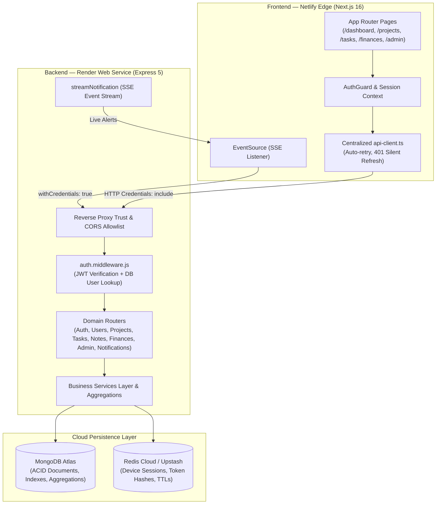

# WorkFlowX — Considered Workspace & Productivity Suite

[](https://nextjs.org/)
[](https://react.dev/)
[](https://www.typescriptlang.org/)
[](https://tailwindcss.com/)
[](https://nodejs.org/)
[](https://expressjs.com/)
[](https://www.mongodb.com/)
[-DC382D?logo=redis)](https://redis.io/)
[](#-security--resilience-architecture)

> **WorkFlowX** is a unified, high-performance personal workspace and productivity management platform. Built on modern full-stack architectures (**Next.js App Router, Express 5, MongoDB Atlas, and Redis**), it consolidates **Projects, Tasks, Notes, Financial Tracking, Real-Time Notifications, and Administrative Governance** into a calm, focused, distraction-free interface.

---
##  Live Demo

### 👨🏻‍💻 **Explore the Live Project:** [Click Here](https://workflowsx.netlify.app/)

###  **Live URL:** [https://workflowsx.netlify.com](https://workflowsx.netlify.app/)

##  Table of Contents

- [Architectural Overview](#-architectural-overview)
- [Key Features](#-key-features)
  - [1. Authentication & Multi-Device Session Management](#1-authentication--multi-device-session-management)
  - [2. Projects & Milestone Engine](#2-projects--milestone-engine)
  - [3. Tasks & Priority Workflow](#3-tasks--priority-workflow)
  - [4. Notes & Tagging Knowledge Base](#4-notes--tagging-knowledge-base)
  - [5. Personal Finances & Aggregated Balance](#5-personal-finances--aggregated-balance)
  - [6. Real-Time Activity & Deadline Alerts (SSE)](#6-real-time-activity--deadline-alerts-sse)
  - [7. Administrative Governance & RBAC](#7-administrative-governance--rbac)
  - [8. Responsive Design & Mobile Drawer](#8-responsive-design--mobile-drawer)
- [Security & Resilience Architecture](#-security--resilience-architecture)
- [Monorepo Directory Structure](#-monorepo-directory-structure)
- [REST API Reference Matrix](#-rest-api-reference-matrix)
- [Local Development Setup](#-local-development-setup)
- [Production Deployment Guide](#-production-deployment-guide)
  - [Deploying Backend to Render](#deploying-backend-to-render)
  - [Deploying Frontend to Netlify](#deploying-frontend-to-netlify)
- [License & Credits](#-license--credits)

---

##  System Architecture

WorkFlowX separates concerns cleanly between a fast, accessible **Next.js 16 Client SPA** and a modular, domain-driven **Express 5 REST API** backed by persistent MongoDB document storage and in-memory Redis session caching.



---

##  Key Features

### 1. Authentication & Multi-Device Session Management
- **Stateless Access Tokens + Stateful Refresh Tokens:** Short-lived JWTs (15 min) paired with cryptographically random 80-character refresh tokens (7 days).
- **Device Fingerprinting:** Captures browser, OS, device model, IP, and last active timestamp for each sign-in.
- **Session Revocation:** Users can view all active logged-in sessions in `/settings/sessions` and terminate specific devices or revoke all devices at once.
- **Silent Token Rotation:** Transparently recovers expired access tokens on `401 Unauthorized` without forcing user re-authentication or losing unsaved work.

### 2. Projects & Milestone Engine
- Comprehensive project tracking with custom deadlines, status workflows (`active`, `paused`, `completed`), and technology stack tags.
- Direct relational association linking tasks to specific parent projects.
- Search and filtering by status and project title with automated deadline warnings.

### 3. Tasks & Priority Workflow
- Granular task statuses (`todo`, `in_progress`, `completed`) and priority grading (`low`, `medium`, `high`).
- Dynamic task associations linking directly to parent projects or standalone workspaces.
- Real-time overdue deadline calculation and automated completion metrics.

### 4. Notes & Tagging Knowledge Base
- Rich note composition with custom title, body, and category tags.
- Top-pinned notes feature keeping essential thoughts and documentation immediately visible on the main dashboard.
- Case-insensitive search across note content and tags.

### 5. Personal Finances & Aggregated Balance
- Multi-category financial ledger tracking both **Income** and **Expense** transactions.
- Automated balance calculations: Instant monthly net balance (`Income - Expenses`).
- Visualized breakdowns by spending categories and chronological transaction lists.

### 6. Real-Time Activity & Deadline Alerts (SSE)
- Built on **Server-Sent Events (SSE)** via `/api/v1/notifications/stream`.
- Real-time alert delivery when tasks near their deadline or when projects change state.
- Automated background evaluation of urgent deadlines with live badge counters.

### 7. Administrative Governance & RBAC
- Role-Based Access Control (**RBAC**) strictly enforcing authorization between regular `user` and `admin` roles.
- Dedicated `/admin` control room with platform-wide volume, user counts, and cascade deletion tools.
- Prevention of privilege escalation: Admin roles cannot be assigned via URLs, queries, or client registration payloads.

### 8. Responsive Design & Mobile Drawer
- Bespoke desktop and mobile interface designed with a calm, tactile aesthetic (warm neutrals `#f4f3ee`, dark surfaces `#292e2b`, and focused orange accents `#f06442`).
- Responsive off-canvas slide-out navigation drawer with gesture backdrop, keyboard `Escape` dismissal, and body scroll lock.

---

##  Security & Resilience Architecture

WorkFlowX was hardened to follow enterprise security standards:

1. **NoSQL Query Selector Injection Protection:**
   - Strict string and primitive type enforcement across authentication and profile endpoints preventing `{ "$gt": "" }` or `{ "$ne": null }` operator injection attacks.
2. **ReDoS (Regular Expression Denial of Service) Prevention:**
   - Search parameters across all entities (Users, Projects, Tasks, Notes, Finances) automatically escape special regex metacharacters (`replace(/[.*+?^${}()|[\]\\]/g, '\\$&')`).
3. **Cross-Site Cookie Security (`SameSite=None; Secure=true`):**
   - Configured for modern cross-origin cloud topologies (Frontend on Netlify, Backend on Render), ensuring HttpOnly session cookies are transmitted securely over HTTPS while blocking unauthorized cross-origin tampering.
4. **Reverse Proxy & Header Trust:**
   - Node Express configured with `app.set('trust proxy', 1)` to accurately detect client protocols and IP addresses behind Cloudflare/Render load balancers.
5. **Runtime Schema Validation:**
   - Powered by **Zod** across domain endpoints, validating input lengths, hexadecimal MongoDB ObjectIDs, and expected schemas before queries execute.

---

##  Monorepo Directory Structure

```text
workFlowX/
├── workFlowX-backend/              # Express 5 REST API & WebSocket/SSE Server
│   ├── src/
│   │   ├── config/                 # Database (Mongoose) & Cache (ioredis) connectors
│   │   ├── features/               # Modular domain feature architecture
│   │   │   ├── admin/              # RBAC administration controllers, routes & services
│   │   │   ├── auth/               # Multi-device JWT authentication & sessions
│   │   │   ├── dashboard/          # Aggregated dashboard metrics & calculations
│   │   │   ├── notes/              # Notes CRUD, tagging, and pinning
│   │   │   ├── notifications/      # Real-time SSE stream & alert triggers
│   │   │   ├── projects/           # Projects management & status pipelines
│   │   │   ├── tasks/              # Task engine, deadline tracking, priorities
│   │   │   ├── transactions/       # Income/Expense tracking & net calculations
│   │   │   └── users/              # User profile services & data
│   │   ├── middlewares/            # Error handling, auth guards, schema validators
│   │   ├── services/               # Internal EventBus & notification emitters
│   │   ├── stores/                 # Redis device session stores & token rotation
│   │   ├── utils/                  # AppError, catchAsync, deviceInfo, sendEmail
│   │   ├── app.js                  # Express application setup, CORS, and routes
│   │   └── server.js               # Server initialization & database bootstrap
│   ├── .env.example                # Backend environment variable template
│   └── package.json
│
├── workFlowX-frontend/             # Next.js 16 App Router Frontend
│   ├── app/                        # Next.js App Router pages
│   │   ├── admin/                  # Administrative dashboard & user controls
│   │   ├── dashboard/              # Central workspace dashboard
│   │   ├── finances/               # Transaction registers, categories, new flows
│   │   ├── notes/                  # Notes workspace & editor
│   │   ├── notifications/          # Real-time notification center (SSE)
│   │   ├── projects/               # Projects list, detail, and form layouts
│   │   ├── settings/               # Profile, security, and multi-device sessions
│   │   ├── tasks/                  # Task board & deadline views
│   │   ├── globals.css             # Unified styling, theme tokens & responsive drawer
│   │   └── layout.tsx              # Root HTML layout with AuthProvider & AuthGuard
│   ├── components/                 # Reusable React components & layout rails
│   │   ├── admin-layout.tsx        # Admin control room layout wrapper
│   │   ├── auth-guard.tsx          # Client-side route protection & RBAC redirector
│   │   ├── providers.tsx           # Global React context providers
│   │   ├── settings-layout.tsx     # Account settings navigation rail
│   │   └── signout-button.tsx      # Multi-device session logout trigger
│   ├── lib/                        # Client-side utilities & API communication
│   │   ├── api/                    # Typed API client services per domain
│   │   ├── api-client.ts           # Centralized fetch client with token refresh
│   │   ├── auth-context.tsx        # User authentication state provider
│   │   └── types.ts                # TypeScript entity contracts & response types
│   ├── public/                     # Static icons, vector assets, and brand assets
│   ├── .env.example                # Frontend environment variable template
│   └── package.json
│
└── README.md                       # Project documentation
```

---

##  REST API Reference Matrix

All endpoints are versioned under `/api/v1`.

| Domain | Method | Endpoint | Access | Purpose |
|---|---|---|---|---|
| **Health** | `GET` | `/health` | Public | Cloud health check endpoint |
| **Auth** | `POST` | `/api/v1/auth/register` | Public | Create new account & initiate device session |
| **Auth** | `POST` | `/api/v1/auth/login` | Public | Authenticate user & issue HttpOnly JWT cookies |
| **Auth** | `POST` | `/api/v1/auth/refresh` | Public | Rotate refresh token & issue new access token |
| **Auth** | `POST` | `/api/v1/auth/logout` | Authenticated | Terminate current device session & clear cookies |
| **Auth** | `POST` | `/api/v1/auth/forgot-password`| Public | Generate reset token & send recovery email |
| **Auth** | `POST` | `/api/v1/auth/reset-password/:token`| Public | Reset account password using verified token |
| **Sessions** | `GET` | `/api/v1/auth/sessions` | Authenticated | List all active device sessions for current user |
| **Sessions** | `DELETE`| `/api/v1/auth/sessions/:id` | Authenticated | Revoke a specific remote device session |
| **Sessions** | `DELETE`| `/api/v1/auth/sessions` | Authenticated | Terminate all other sessions across all devices |
| **Dashboard** | `GET` | `/api/v1/dashboard/stats` | Authenticated | Aggregate workspace metrics (Tasks, Projects, Balance) |
| **Projects** | `GET` | `/api/v1/projects` | Authenticated | List projects with search, status filters & pagination |
| **Projects** | `POST` | `/api/v1/projects` | Authenticated | Create a new project record |
| **Projects** | `GET` | `/api/v1/projects/:id` | Authenticated | Fetch project details and child tasks |
| **Projects** | `PATCH`| `/api/v1/projects/:id` | Authenticated | Update project title, status, or deadline |
| **Projects** | `DELETE`| `/api/v1/projects/:id` | Authenticated | Cascade delete project and associated tasks |
| **Tasks** | `GET` | `/api/v1/tasks` | Authenticated | List tasks with priority, status, and project filters |
| **Tasks** | `POST` | `/api/v1/tasks` | Authenticated | Create a task |
| **Tasks** | `PATCH`| `/api/v1/tasks/:id` | Authenticated | Update task priority, status, or deadline |
| **Tasks** | `DELETE`| `/api/v1/tasks/:id` | Authenticated | Remove task |
| **Notes** | `GET` | `/api/v1/notes` | Authenticated | List notes with tag filters, pinned filter, and search |
| **Notes** | `POST` | `/api/v1/notes` | Authenticated | Create a new note |
| **Notes** | `PATCH`| `/api/v1/notes/:id` | Authenticated | Update note content or toggle pinned state |
| **Notes** | `DELETE`| `/api/v1/notes/:id` | Authenticated | Delete note |
| **Finances** | `GET` | `/api/v1/transactions` | Authenticated | List income/expense entries with search & filters |
| **Finances** | `POST` | `/api/v1/transactions` | Authenticated | Record new financial transaction |
| **Finances** | `GET` | `/api/v1/transactions/analytics`| Authenticated| Aggregate spending by category & net balance |
| **Notifications**| `GET` | `/api/v1/notifications/stream`| Authenticated | Server-Sent Events (SSE) live event connection |
| **Notifications**| `GET` | `/api/v1/notifications` | Authenticated | Fetch paginated notification history |
| **Notifications**| `PATCH`| `/api/v1/notifications/read-all`| Authenticated| Mark all unread alerts as read |
| **Admin** | `GET` | `/api/v1/admin/stats` | Admin Only | System-wide platform metrics & volume |
| **Admin** | `GET` | `/api/v1/admin/users` | Admin Only | User registry with search & pagination |
| **Admin** | `PATCH`| `/api/v1/admin/users/:id/role`| Admin Only | Promote or demote user roles (`user` / `admin`) |
| **Admin** | `DELETE`| `/api/v1/admin/users/:id` | Admin Only | Cascade delete user account and all workspace data |

---

##  Local Development Setup

### Prerequisites
- [Node.js](https://nodejs.org/) v20.x or higher
- [pnpm](https://pnpm.io/) v9.x or higher
- [MongoDB](https://www.mongodb.com/) (Local instance or Atlas connection string)
- [Redis](https://redis.io/) (Local service or free [Upstash Redis](https://upstash.com) instance)

### 1. Clone Repository
```bash
git clone https://github.com/your-username/workFlowX.git
cd workFlowX
```

### 2. Backend Setup
```bash
cd workFlowX-backend
npm install
```

Create `.env` inside `workFlowX-backend/`:
```env
PORT=5000
NODE_ENV=development
MONGO_URI=mongodb://127.0.0.1:27017/workflowx
REDIS_URI=redis://127.0.0.1:6379
ACCESS_TOKEN_SECRET=super_secret_access_key_at_least_32_characters
REFRESH_TOKEN_SECRET=super_secret_refresh_key_at_least_32_characters
FRONTEND_URL=http://localhost:3000
EMAIL_USER=your-email@gmail.com
EMAIL_PASSWORD=your-google-app-password
```

Start the backend development server:
```bash
npm start
# Server running at http://localhost:5000
```

### 3. Frontend Setup
```bash
cd ../workFlowX-frontend
pnpm install
```

Create `.env.local` inside `workFlowX-frontend/`:
```env
NEXT_PUBLIC_API_URL=http://localhost:5000
```

Start the Next.js frontend development server:
```bash
pnpm dev
# Client running at http://localhost:3000
```

Open [http://localhost:3000](http://localhost:3000) in your browser.

---

## Author

- **Author:** [Prashant Kumar](https://github.com/Prashant01pro)

