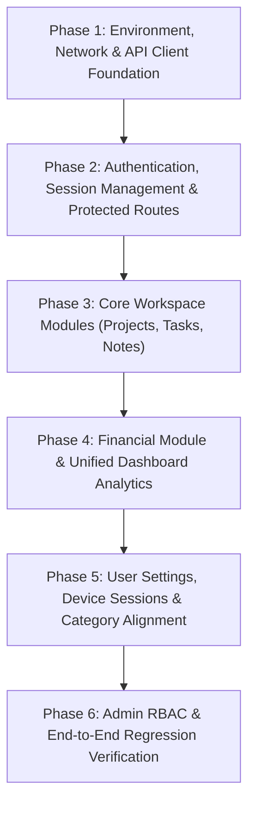

# WorkFlowX — Full-Stack Integration Audit Report (Updated)

**Date of Audit:** October 25, 2026  
**Auditor:** Senior Full-Stack Integration Engineer  
**Frontend Application:** Next.js 16.4.0 (App Router), React 19, TypeScript 5.7.3, Tailwind CSS 4.3.3 (`workFlowX-frontend`)  
**Backend Application:** Node.js (ESM), Express 5.2.1, MongoDB / Mongoose 9.10.3, Upstash Redis 6.0.0, Zod 4.6.5 (`workFlowX-backend`)  
**Audit Revision:** Updated to reflect the newly created Frontend Settings and Admin pages (`/settings/profile`, `/settings/security`, `/settings/sessions`, `/admin`, `/admin/users`, `/admin/users/[id]`, `components/settings-layout.tsx`, `components/admin-layout.tsx`, and `lib/api-client.ts`).

---

## Table of Contents
1. [A. Executive Summary](#a-executive-summary)
2. [B. Complete Frontend Route Inventory](#b-complete-frontend-route-inventory)
3. [C. Complete Backend Endpoint Inventory](#c-complete-backend-endpoint-inventory)
4. [D. Frontend-to-Backend Route Comparison](#d-frontend-to-backend-route-comparison)
5. [E. Missing Frontend Routes](#e-missing-frontend-routes)
6. [F. Missing Backend Endpoints](#f-missing-backend-endpoints)
7. [G. Deep-Dive Contract Mismatches](#g-deep-dive-contract-mismatches)
8. [H. Security, Networking & Authentication Concerns](#h-security-networking--authentication-concerns)
9. [I. Existing Tests & Verification Status](#i-existing-tests--verification-status)
10. [J. Prioritized Integration Roadmap](#j-prioritized-integration-roadmap)
11. [K. Exact Files Requiring Changes in Each Phase](#k-exact-files-requiring-changes-in-each-phase)
12. [L. Acceptance Criteria for Every Phase](#l-acceptance-criteria-for-every-phase)

---

## A. Executive Summary

WorkFlowX is an integrated personal productivity workspace combining project planning, task tracking, note-taking, and financial accounting with multi-device session management and role-based access control.

Following the creation of the missing settings and administration pages in the frontend repository (`workFlowX-frontend`), **the system has advanced significantly in UI coverage (from 24 to 30 routes)**. The previously dead navigation links to `/settings/profile` and `/settings/security` are now backed by real Next.js page components, a new active device session management screen has been added, and an entire Admin portal (`/admin`, `/admin/users`, `/admin/users/[id]`) has been scaffolded alongside a centralized API client (`lib/api-client.ts`).

### Current Integration State:
1. **Frontend Coverage:** **30 total routes** are now implemented. The frontend now has views corresponding to all 27 backend endpoints.
2. **Backend Coverage:** **27 endpoints** fully implemented across Auth, Users, Projects, Tasks, Notes, Transactions, Dashboard, and Admin.
3. **New Critical Blockers Uncovered in New Pages:**
   - **HTTP Method Mismatch on Change Password:** `app/settings/security/page.tsx` calls `POST /api/v1/auth/change-password`, but the backend route is explicitly defined as `PATCH /api/v1/auth/change-password`.
   - **Session Object Shape Mismatch:** `app/settings/sessions/page.tsx` expects flat `browser`, `os`, `ip`, and boolean `current`. The backend delivers these nested inside `deviceInfo: { browser, os, ip }` and flags `isCurrentDevice`.
   - **Admin Response Envelope Mismatch:** 
     - `GET /api/v1/admin/stats` returns `{ status: 'success', data: { totalUsers, ... } }`. Frontend expects a flat object, causing metrics to disappear.
     - `GET /api/v1/admin/users/:id` returns `{ status: 'success', data: { user: {...}, resourceSummary: {...} } }`. Frontend unwraps `data` directly into `user`, nesting the real user object and rendering `user.name` as `undefined`.
   - **API Client Base URL & Proxy:** `lib/api-client.ts` uses relative paths (`fetch('/api/v1/...')`). Without Next.js proxy rewrites or an explicit `NEXT_PUBLIC_API_URL` prefix pointing to `http://localhost:5000`, all client-side calls target Next.js port 3000 instead of Express.
   - **Zero CORS on Backend:** Express still lacks the `cors` middleware, which will reject any browser fetch from Next.js.
   - **Port Collision:** Backend `.env` remains set to `PORT=3000` (colliding with Next.js).

---

## B. Complete Frontend Route Inventory

| Route | Page File Path | Rendering State | Data Source | Functional Actions Available | Incomplete / Broken Actions / Status |
|---|---|---|---|---|---|
| `/` | `app/page.tsx` | Renders fully | Static marketing text & SVGs | Navigation links to `/login`, `/register`, internal anchors | `#about`, `#product`, `#features` are anchor links |
| `/login` | `app/login/page.tsx` | Renders fully | Mock state | Email & password form submission | Fake 650ms timeout; no backend API call; no token storage |
| `/register` | `app/register/page.tsx` | Renders fully | Mock state | Full registration form with terms checkbox | Fake 650ms timeout; requires 8-char password (backend requires 10) |
| `/forgot-password` | `app/forgot-password/page.tsx` | Renders fully | Mock state | Email input for password reset link | Fake 650ms timeout; no email trigger |
| `/reset-password` | `app/reset-password/page.tsx` | Renders fully | URL query search params | Form for new password and confirmation | Extracts `?token=` from URL; fake 650ms timeout; does not call backend `:token` route |
| `/dashboard` | `app/dashboard/page.tsx` | Renders empty shell | Hardcoded `hasBackend = false` | Links to `/projects/new`, `/tasks/new`, `/notes/new` | Metrics and widgets display "—" and "Awaiting account connection" |
| `/projects` | `app/projects/page.tsx` | Renders list | Hardcoded array (2 projects: `demo`, `studio`) | In-memory search and status filtering; link to `/projects/new` | Does not fetch from `/api/v1/projects`; metrics are hardcoded |
| `/projects/new` | `app/projects/new/page.tsx` | Renders form | Local component state | Title, description, status, deadline, tech stack tag adder | Submit sets error: "Project creation is not connected yet" |
| `/projects/[id]` | `app/projects/[id]/page.tsx` | Renders empty shell | Static text | Breadcrumbs, back button, dropdown menu toggle | Does not read route param; "Delete unavailable" menu item; static "No project selected" |
| `/projects/[id]/edit` | `app/projects/[id]/edit/page.tsx` | Renders form | Hardcoded initial values | Form fields with title, description, status, deadline | Submit sets error: "Project updates are not connected yet" |
| `/tasks` | `app/tasks/page.tsx` | Renders empty shell | Hardcoded `hasBackend = false` | Link to `/tasks/new`, search input (disabled), dropdowns (disabled) | No tasks loaded; filter dropdowns have single placeholder options |
| `/tasks/new` | `app/tasks/new/page.tsx` | Renders form | Local form state | Title, description, priority select, due date, project select | Priority dropdown only has "Not set"; Project dropdown only has "No project"; mock submit |
| `/tasks/[id]` | `app/tasks/[id]/page.tsx` | Renders empty shell | Static text | Back link, actions menu toggle | Does not read route param; "Delete unavailable" menu item; static placeholder |
| `/tasks/[id]/edit` | `app/tasks/[id]/edit/page.tsx` | Renders form | Static placeholders | Form inputs with hardcoded default values | Inputs disabled/placeholder; mock submit; no load or patch |
| `/notes` | `app/notes/page.tsx` | Renders empty shell | Hardcoded `hasBackend = false` | Link to `/notes/new`, tabs (Pinned, Archived - disabled) | No notes loaded; "Archived" tab has no backend counterpart |
| `/notes/new` | `app/notes/new/page.tsx` | Renders form | Local form state | Title and content inputs, cancel/submit buttons | Submitting only sets inline error; does not support tags, pin, or project |
| `/notes/[id]` | `app/notes/[id]/page.tsx` | Renders empty shell | Reads path segment | "Back to notes", "Edit note" | Static "Note unavailable"; NO delete option provided |
| `/notes/[id]/edit` | `app/notes/[id]/edit/page.tsx` | Renders form | Reads path segment | Disabled title and content fields | Fields are HTML `disabled`; mock submit |
| `/finances` | `app/finances/page.tsx` | Renders empty shell | Static text | Links to `/finances/categories`, `/finances/transactions` | Metrics show "—"; empty panels for activity and breakdown |
| `/finances/categories` | `app/finances/categories/page.tsx` | Renders directory notice | Hardcoded empty list | Search & filter buttons (disabled) | Explicit notice stating category backend is absent; no actions work |
| `/finances/transactions` | `app/finances/transactions/page.tsx` | Renders empty shell | Static text | Link to `/finances/transactions/new` | Metrics show "—"; toolbar search disabled |
| `/finances/transactions/new` | `app/finances/transactions/new/page.tsx` | Renders form | Local form state | Type toggle (expense/income), amount, date, description, category | Submit triggers 350ms fake timeout; description is marked mandatory |
| `/finances/transactions/[id]` | `app/finances/transactions/[id]/page.tsx` | Renders empty shell | Reads path segment | "Return to transactions", Delete button | Clicking Delete opens dialog: "There is no connected backend, so no deletion request can be made" |
| `/finances/transactions/[id]/edit` | `app/finances/transactions/[id]/edit/page.tsx` | Renders form | Reads path segment | Cancel link, submit button | Form fields are replaced by static warning "Saved values unavailable"; mock submit |
| `/settings/profile` **(NEW)** | `app/settings/profile/page.tsx` | Renders real form | `GET /api/v1/auth/profile` | Loads profile data, edits bio, submits `PATCH /api/v1/auth/update-profile` | Functional API client connection ready; needs base URL / CORS |
| `/settings/security` **(NEW)** | `app/settings/security/page.tsx` | Renders real form | Local form state | Form fields for current, new, and confirm password | Calls `POST` instead of `PATCH`; validates 8 chars instead of 10 |
| `/settings/sessions` **(NEW)** | `app/settings/sessions/page.tsx` | Renders real list | `GET /api/v1/auth/sessions` | Lists devices, confirms and dispatches `DELETE /api/v1/auth/sessions/:sessionId` | Expects flat device fields instead of nested `deviceInfo`; missing bulk logout button |
| `/admin` **(NEW)** | `app/admin/page.tsx` | Renders admin overview | `GET /api/v1/admin/stats` | Loads system statistics, links to user management | Expects flat metric object instead of nested `data: { ... }` |
| `/admin/users` **(NEW)** | `app/admin/users/page.tsx` | Renders users table | `GET /api/v1/admin/users` | Filters by search query, views user details, deletes user via `DELETE /api/v1/admin/users/:id` | Functional table; missing server-side pagination controls |
| `/admin/users/[id]` **(NEW)** | `app/admin/users/[id]/page.tsx` | Renders user inspector | `GET /api/v1/admin/users/:id` | Displays user details, dispatches `DELETE /api/v1/admin/users/:id` | Unwraps `data` incorrectly (nests `user`); missing role update toggle |
| `/unauthorized` | `app/unauthorized/page.tsx` | Renders error view | Static copy | Link to `/login` | Functional static error page (401) |
| `/forbidden` | `app/forbidden/page.tsx` | Renders error view | Static copy | Link to `/dashboard` | Functional static error page (403) |
| `/network-error` | `app/network-error/page.tsx` | Renders error view | Static copy | "Retry" action button | Functional static error page (Network) |
| `not-found.tsx` | `app/not-found.tsx` | Renders error view | Static copy | Link to `/` and Back | Next.js 404 page |
| `error.tsx` | `app/error.tsx` | Renders error view | Dynamic Error object | Retry reset button | Next.js route error boundary (500) |
| `global-error.tsx` | `app/global-error.tsx` | Renders error view | Dynamic Error object | Retry reset button | Next.js global root boundary (500) |

---

## C. Complete Backend Endpoint Inventory

All routes are prefixed by `/api/v1` except `/health`.

| HTTP Verb | Path | Controller Function | Service Function | Model / Store | Guard / Middleware | Inputs (Params / Query / Body) | Status & Response Format |
|---|---|---|---|---|---|---|---|
| `GET` | `/health` | Inline handler | None | None | Public | None | `200 OK`: `{ message: 'Server is running' }` |
| `POST` | `/api/v1/auth/register` | `register` | `registerService` | `User`, Redis (`createSession`) | Public | Body: `{ name, email, password, bio? }` | `201 Created`: `{ message, accessToken, sessionId, user: { id, name, email } }` + Sets 3 cookies |
| `POST` | `/api/v1/auth/login` | `login` | `loginServices` | `User`, Redis (`createSession`) | Public | Body: `{ email, password }` | `201 Created`: `{ message, accessToken, sessionId, user: { id, name, email } }` + Sets 3 cookies |
| `POST` | `/api/v1/auth/refresh` | `refresh` | `refreshServices` | Redis (`getSession`, `updateSessionToken`) | Public (Cookie/Body) | Cookie or Body: `refreshToken` (or `refresh`), `sessionId` | `200 OK`: `{ newAccessToken, message }` + Sets updated cookies |
| `POST` | `/api/v1/auth/logout` | `logout` | `logoutServices` | Redis (`deleteSession`) | `authenticate` | None (reads `req.sessionId`) | `200 OK`: `{ message: 'Logout Successful' }` + Clears 3 cookies |
| `POST` | `/api/v1/auth/forgot-password` | `forgotPassword` | `forgotPasswordService` | `User`, Nodemailer | Public | Body: `{ email }` | `200 OK`: `{ message: 'if an account exists...' }` |
| `POST` | `/api/v1/auth/reset-password/:token` | `resetPassword` | `resetPasswordService` | `User`, Redis (`deleteAllUserSessions`) | Public | Param: `:token`<br>Body: `{ newPassword }` | `200 OK`: `{ message: 'Password Reset Successfully...' }` |
| `GET` | `/api/v1/auth/profile` | `myprofile` | None (reads `req.user`) | `User` | `authenticate` | None | `200 OK`: `{ user: { _id, name, email, bio, role, createdAt, updatedAt } }` |
| `PATCH` | `/api/v1/auth/update-profile` | `updateProfile` | `updateUserService` | `User` | `authenticate` | Body: `{ bio }` | `200 OK`: `{ user: { _id, bio, createdAt, updatedAt } }` |
| `PATCH` | `/api/v1/auth/change-password` | `changePassword` | `changePasswordService` | `User` | `authenticate` | Body: `{ currentPassword, newPassword }` | `200 OK`: `{ message: 'Password changed successfully' }` |
| `GET` | `/api/v1/auth/sessions` | `getActiveSessions` | `getActiveSessionsService` | Redis (`getUserSessions`) | `authenticate` | None | `200 OK`: `{ sessions: [ { sessionId, deviceInfo: { browser, os, ip }, createdAt, lastActive, isCurrentDevice } ] }` |
| `DELETE` | `/api/v1/auth/sessions/:sessionId` | `revokeSession` | `revokeDeviceSessionService` | Redis (`deleteSession`) | `authenticate` | Param: `:sessionId` | `200 OK`: `{ message: 'Device session revoked successfully' }` |
| `DELETE` | `/api/v1/auth/sessions` | `revokeAllSessions` | `revokeAllSessionsService` | Redis (`deleteAllUserSessions`) | `authenticate` | None | `200 OK`: `{ message: 'Logged out from all devices successfully' }` + Clears 3 cookies |
| `GET` | `/api/v1/users/me` | `me` | `getMeService` | `User` | `authenticate` | None | `200 OK`: `{ id, name, email }` |
| `POST` | `/api/v1/projects` | `createProject` | `createProjectService` | `Project` | `authenticate`, `validateBody(createProjectSchema)` | Body: `{ title, description, techStack?, nonTechStack?, status?, deadline }` | `201 Created`: `{ status: 'success', message, data: { project } }` |
| `GET` | `/api/v1/projects` | `getAllProjects` | `getAllProjectsService` | `Project` | `authenticate` | Query: `status?`, `search?`, `sort?`, `page?`, `limit?` | `200 OK`: `{ status: 'success', projects: [...], pagination: { totalProjects, totalPages, currentPage, limit, hasNextPage, hasPrevPage } }` |
| `GET` | `/api/v1/projects/:id` | `getProjectById` | `getProjectByIdService` | `Project` | `authenticate`, `validateParams(projectIdParamSchema)` | Param: `:id` (24-hex ObjectId) | `200 OK`: `{ status: 'success', data: { project } }` |
| `PATCH` | `/api/v1/projects/:id` | `updateProject` | `updateProjectService` | `Project` | `authenticate`, `validateParams`, `validateBody(updateProjectSchema)` | Param: `:id`<br>Body: partial project fields | `200 OK`: `{ status: 'success', message, data: { project } }` |
| `DELETE` | `/api/v1/projects/:id` | `deleteProject` | `deleteProjectService` | `Project` | `authenticate`, `validateParams` | Param: `:id` | `200 OK`: `{ status: 'success', message: 'Project deleted successfully' }` |
| `POST` | `/api/v1/tasks` | `createTask` | `createTaskService` | `Task`, `Project` | `authenticate`, `validateBody(createTaskSchema)` | Body: `{ title, description?, status?, priority?, dueDate?, project? }` | `201 Created`: `{ status: 'success', message, data: { task } }` |
| `GET` | `/api/v1/tasks` | `getAllTasks` | `getAllTasksService` | `Task`, `Project` | `authenticate` | Query: `status?`, `priority?`, `project?` (`'none'`, `'null'`, or ObjectId), `search?`, `sort?`, `page?`, `limit?` | `200 OK`: `{ status: 'success', tasks: [...], pagination: { totalTasks, totalPages, currentPage, limit, hasNextPage, hasPrevPage } }` |
| `GET` | `/api/v1/tasks/:id` | `getTaskById` | `getTaskByIdService` | `Task`, `Project` | `authenticate`, `validateParam(taskIdParamSchema)` | Param: `:id` | `200 OK`: `{ status: 'success', data: { task } }` |
| `PATCH` | `/api/v1/tasks/:id` | `updateTask` | `updateTaskService` | `Task`, `Project` | `authenticate`, `validateParam`, `validateBody(updateTaskSchema)` | Param: `:id`<br>Body: partial task fields | `200 OK`: `{ status: 'success', message, data: { task } }` |
| `DELETE` | `/api/v1/tasks/:id` | `deleteTask` | `deleteTaskService` | `Task` | `authenticate`, `validateParam` | Param: `:id` | `200 OK`: `{ status: 'success', message: 'Task deleted successfully' }` |
| `POST` | `/api/v1/notes` | `createNote` | `createNoteService` | `Note`, `Project` | `authenticate`, `validateBody(createNoteSchema)` | Body: `{ title, content, tags?, isPinned?, project? }` | `201 Created`: `{ status: 'success', message, data: { note } }` |
| `GET` | `/api/v1/notes` | `getAllNotes` | `getAllNotesService` | `Note`, `Project` | `authenticate` | Query: `project?`, `isPinned?`, `tag?`, `tags?`, `search?`, `sort?`, `page?`, `limit?` | `200 OK`: `{ status: 'success', notes: [...], pagination: { totalNotes, totalPages, currentPage, limit, hasNextPage, hasPrevPage } }` |
| `GET` | `/api/v1/notes/:id` | `getNoteById` | `getNoteByIdService` | `Note`, `Project` | `authenticate`, `validateParams(noteIdParamsSchema)` | Param: `:id` | `200 OK`: `{ status: 'success', data: { note } }` |
| `PATCH` | `/api/v1/notes/:id` | `updateNote` | `updateNoteService` | `Note`, `Project` | `authenticate`, `validateParams`, `validateBody(updateNoteSchema)` | Param: `:id`<br>Body: partial note fields | `200 OK`: `{ status: 'success', message, data: { note } }` |
| `DELETE` | `/api/v1/notes/:id` | `deleteNote` | `deleteNoteService` | `Note` | `authenticate`, `validateParams` | Param: `:id` | `200 OK`: `{ status: 'success', message: 'Note deleted successfully' }` |
| `GET` | `/api/v1/transactions/summary` | `getTransactionSummary` | `getTransactionSummaryService` | `Transaction` | `authenticate` | Query: `startDate?`, `endDate?` | `200 OK`: `{ status: 'success', data: { totalIncome, totalExpense, netBalance, categoryBreakdown: [{ _id, totalSpent, count }] } }` |
| `POST` | `/api/v1/transactions` | `createTransaction` | `createTransactionService` | `Transaction`, `Project` | `authenticate`, `validateBody(createTransactionSchema)` | Body: `{ type, amount, category, description?, date?, project? }` | `201 Created`: `{ status: 'success', message, data: { transaction } }` |
| `GET` | `/api/v1/transactions` | `getAllTransactions` | `getAllTransactionsService` | `Transaction`, `Project` | `authenticate` | Query: `type?`, `category?`, `project?`, `startDate?`, `endDate?`, `search?`, `sort?`, `page?`, `limit?` | `200 OK`: `{ status: 'success', transactions: [...], pagination: { totalTransactions, totalPages, currentPage, limit, hasNextPage, hasPrevPage } }` |
| `GET` | `/api/v1/transactions/:id` | `getTransactionById` | `getTransactionByIdService` | `Transaction`, `Project` | `authenticate`, `validateParams(transactionIdParamSchema)` | Param: `:id` | `200 OK`: `{ status: 'success', data: { transaction } }` |
| `PATCH` | `/api/v1/transactions/:id` | `updateTransaction` | `updateTransactionService` | `Transaction`, `Project` | `authenticate`, `validateParams`, `validateBody(updateTransactionSchema)` | Param: `:id`<br>Body: partial transaction fields | `200 OK`: `{ status: 'success', message, data: { transaction } }` |
| `DELETE` | `/api/v1/transactions/:id` | `deleteTransaction` | `deleteTransactionService` | `Transaction` | `authenticate`, `validateParams` | Param: `:id` | `200 OK`: `{ status: 'success', message: 'Transaction deleted successfully' }` |
| `GET` | `/api/v1/dashboard` | `getDashboardStats` | `getDashboardStatsService` | `Project`, `Task`, `Note`, `Transaction` | `authenticate` | None | `200 OK`: `{ status: 'success', data: { projects: { total, active, completed, paused, archived }, tasks: { total, todo, in_progress, completed, overdue }, notes: { total, pinned }, finances: { totalIncome, totalExpense, netBalance }, upcomingTasks: [...] } }` |
| `GET` | `/api/v1/admin/stats` | `getSystemStats` | `getSystemStatsService` | `User`, `Project`, `Task`, `Note`, `Transaction` | `authenticate`, `authorize('admin')` | None | `200 OK`: `{ status: 'success', data: { totalUsers, totalProjects, totalTasks, totalNotes, totalTransactions, totalPlatformVolume } }` |
| `GET` | `/api/v1/admin/users` | `getAllUsers` | `getAllUsersService` | `User` | `authenticate`, `authorize('admin')` | Query: `role?`, `search?`, `page?`, `limit?` | `200 OK`: `{ status: 'success', users: [...], pagination: { totalUsers, totalPages, currentPage, limit } }` |
| `GET` | `/api/v1/admin/users/:id` | `getUserDetails` | `getUserDetailsByIdService` | `User`, `Project`, `Task`, `Note`, `Transaction` | `authenticate`, `authorize('admin')` | Param: `:id` | `200 OK`: `{ status: 'success', data: { user, resourceSummary: { projectsCount, tasksCount, notesCount, transactionsCount } } }` |
| `PATCH` | `/api/v1/admin/users/:id/role` | `updateUserRole` | `updateUserRoleService` | `User` | `authenticate`, `authorize('admin')` | Param: `:id`<br>Body: `{ role }` | `200 OK`: `{ status: 'success', message, data: { user } }` |
| `DELETE` | `/api/v1/admin/users/:id` | `deleteUser` | `deleteUserCascadeService` | `User`, `Project`, `Task`, `Note`, `Transaction`, Redis | `authenticate`, `authorize('admin')` | Param: `:id` | `200 OK`: `{ status: 'success', message: 'User and all associated data permanently deleted' }` |
| `DELETE` | `/api/v1/admin/projects/:id` | `adminDeleteProject` | `adminDeleteProjectService` | `Project`, `Task` | `authenticate`, `authorize('admin')` | Param: `:id` | `200 OK`: `{ status: 'success', message: 'Project and associated tasks deleted by admin' }` |
| `DELETE` | `/api/v1/admin/tasks/:id` | `adminDeleteTask` | `adminDeleteTaskService` | `Task` | `authenticate`, `authorize('admin')` | Param: `:id` | `200 OK`: `{ status: 'success', message: 'Task deleted by admin' }` |

---

## D. Frontend-to-Backend Route Comparison

| Frontend Route & Action | Expected HTTP Method & Endpoint | Actual Backend Route | Expected Payload / Params | Auth Required | Status | Discrepancy & Missing Functionality | Recommended Next Action |
|---|---|---|---|---|---|---|---|
| `/register` (Submit) | `POST /api/v1/auth/register` | `POST /api/v1/auth/register` | Body: `{ name, email, password }` | No | `CONTRACT_MISMATCH` | Frontend requires 8 chars; backend strictly enforces 10 chars. Frontend has no bio field. | Align password validation to `>=10` on frontend. Call endpoint, handle HTTP 201 and cookies. |
| `/login` (Submit) | `POST /api/v1/auth/login` | `POST /api/v1/auth/login` | Body: `{ email, password }` | No | `MATCH` | Endpoint exists and accepts `{ email, password }`. Frontend uses `setTimeout`. | Connect `login()` API call via `apiRequest`, receive cookies, redirect to `/dashboard`. |
| Session restoration | `GET /api/v1/auth/profile` or `/api/v1/users/me` | Both exist | None | Yes | `CONTRACT_MISMATCH` | Duplicate current-user endpoints. `/auth/profile` returns `{ user: {...} }`; `/users/me` returns `{ id, name, email }`. | Standardize on `/auth/profile` for frontend auth state hydration. |
| Token refresh | `POST /api/v1/auth/refresh` | `POST /api/v1/auth/refresh` | Cookies: `refreshToken`, `sessionId` | No (Cookie) | `MATCH` | Implemented in backend with Redis rotation. Not called anywhere in frontend. | Implement auto-refresh interceptor in `lib/api-client.ts` on 401 response. |
| Sign out | `POST /api/v1/auth/logout` | `POST /api/v1/auth/logout` | None (reads `req.sessionId`) | Yes | `MATCH` | Sidebar links simply redirect to `/login` without calling API to invalidate Redis session. | Add logout handler calling `POST /api/v1/auth/logout` with credentials to clear cookies. |
| `/forgot-password` (Submit) | `POST /api/v1/auth/forgot-password` | `POST /api/v1/auth/forgot-password` | Body: `{ email }` | No | `MATCH` | Backend sends email with reset token. Frontend simulates with `setTimeout`. | Connect form to backend endpoint; show success notification. |
| `/reset-password` (Submit) | `POST /api/v1/auth/reset-password/:token` | `POST /api/v1/auth/reset-password/:token` | Param: `:token`<br>Body: `{ newPassword }` | No | `CONTRACT_MISMATCH` | 1. URL format: Frontend reads `?token=XYZ`, backend sends `/reset-password/:token`.<br>2. Payload: Frontend sends `password`, backend expects `newPassword`.<br>3. Length: Frontend allows 8, backend requires 10. | Harmonize: Send `:token` in URL path; rename body to `newPassword`; enforce `>=10` chars. |
| `/settings/profile` (Load) | `GET /api/v1/auth/profile` | `GET /api/v1/auth/profile` | None | Yes | `MATCH` | Component is now created and wired to `/api/v1/auth/profile`. | Add base URL configuration so client calls reach backend on port 5000. |
| `/settings/profile` (Update Bio) | `PATCH /api/v1/auth/update-profile` | `PATCH /api/v1/auth/update-profile` | Body: `{ bio }` | Yes | `MATCH` | Component is now created and sends `{ bio }` via PATCH. | Verify with active session. |
| `/settings/security` (Change Password) | `PATCH /api/v1/auth/change-password` | `PATCH /api/v1/auth/change-password` | Body: `{ currentPassword, newPassword }` | Yes | `CONTRACT_MISMATCH` | **Method mismatch**: Frontend calls `POST`, backend route requires `PATCH`. Password length validation allows 8 chars; backend requires 10. | Change method to `PATCH` in `SecuritySettingsPage`; update validation to `>=10`. |
| `/settings/sessions` (List) | `GET /api/v1/auth/sessions` | `GET /api/v1/auth/sessions` | None | Yes | `CONTRACT_MISMATCH` | **Shape mismatch**: Frontend expects flat `browser`, `os`, `ip` and `current`. Backend sends nested `deviceInfo: { browser, os, ip }` and `isCurrentDevice`. | Update `Session` interface and mapping in `SessionsPage` to read `deviceInfo`. |
| `/settings/sessions` (Revoke Single) | `DELETE /api/v1/auth/sessions/:sessionId` | `DELETE /api/v1/auth/sessions/:sessionId` | Param: `:sessionId` | Yes | `MATCH` | Page implements confirmation dialog and calls `DELETE /api/v1/auth/sessions/:id`. | Fully matches contract. |
| `/settings/sessions` (Revoke All) | `DELETE /api/v1/auth/sessions` | `DELETE /api/v1/auth/sessions` | None | Yes | `FRONTEND_MISSING` | Backend provides bulk revocation; frontend page has no "Revoke all other devices" button. | Add "Log out all other devices" button to `SessionsPage`. |
| `/admin` (Overview Stats) | `GET /api/v1/admin/stats` | `GET /api/v1/admin/stats` | None | Admin | `CONTRACT_MISMATCH` | **Envelope mismatch**: Backend wraps metrics in `{ status: 'success', data: { ... } }`. Frontend assumes flat `stats` object. | Unwrap `data.data || data` in `AdminPage` before iterating over entries. |
| `/admin/users` (List) | `GET /api/v1/admin/users` | `GET /api/v1/admin/users` | Query: `role`, `search`, `page`, `limit` | Admin | `MATCH` | Page unwraps `payload.users` correctly; client filtering implemented. | Add pagination controls for `page` and `limit`. |
| `/admin/users` (Delete User) | `DELETE /api/v1/admin/users/:id` | `DELETE /api/v1/admin/users/:id` | Param: `:id` | Admin | `MATCH` | Calls `DELETE /api/v1/admin/users/:id` with confirmation dialog. | Fully matches contract. |
| `/admin/users/[id]` (View Details) | `GET /api/v1/admin/users/:id` | `GET /api/v1/admin/users/:id` | Param: `:id` | Admin | `CONTRACT_MISMATCH` | **Envelope mismatch**: Backend returns `{ data: { user, resourceSummary } }`. Frontend assigns `result.data` to `user`, leaving `user.name` undefined. | Access `result.data.user` and render `result.data.resourceSummary`. |
| `/admin/users/[id]` (Update Role) | `PATCH /api/v1/admin/users/:id/role` | `PATCH /api/v1/admin/users/:id/role` | Param: `:id`<br>Body: `{ role }` | Admin | `FRONTEND_MISSING` | Backend endpoint ready; frontend user details page has no role change toggle. | Add role dropdown (`user` / `admin`) calling `PATCH /api/v1/admin/users/:id/role`. |
| `/dashboard` (Load) | `GET /api/v1/dashboard` | `GET /api/v1/dashboard` | None | Yes | `CONTRACT_MISMATCH` | Backend returns summary counts and `upcomingTasks`. Frontend expects recent projects list and pinned notes. | Fetch `/api/v1/dashboard` for metrics + parallel requests for recent projects & pinned notes. |
| `/projects` (List) | `GET /api/v1/projects` | `GET /api/v1/projects` | Query: `status`, `search`, `page`, `limit` | Yes | `MATCH` | Backend has query filters; frontend filters hardcoded array in memory. | Connect frontend to `/api/v1/projects` via `apiRequest`. |
| `/projects/new` (Submit) | `POST /api/v1/projects` | `POST /api/v1/projects` | Body: `{ title, description, deadline, status, techStack, nonTechStack }` | Yes | `CONTRACT_MISMATCH` | 1. `description` and `deadline` are required on backend, optional in UI.<br>2. Casing: Backend expects `'active'`, UI sends `'Active'`.<br>3. Keys: UI uses `technical`/`nontechnical`, backend uses `techStack`/`nonTechStack`. | Update form validation to require description and deadline; map keys to `techStack`/`nonTechStack`; lowercase status enum. |
| `/projects/[id]` (View) | `GET /api/v1/projects/:id` | `GET /api/v1/projects/:id` | Param: `:id` | Yes | `MATCH` | Route exists; frontend displays static placeholder without reading `params.id`. | Read `use(params).id`, fetch project, display details and related tasks/notes. |
| `/projects/[id]/edit` (Submit) | `PATCH /api/v1/projects/:id` | `PATCH /api/v1/projects/:id` | Param: `:id`<br>Body: partial project fields | Yes | `CONTRACT_MISMATCH` | Status casing mismatch; key names mismatch (`technical` vs `techStack`). | Map form fields to backend schema; dispatch PATCH on save. |
| Project Delete | `DELETE /api/v1/projects/:id` | `DELETE /api/v1/projects/:id` | Param: `:id` | Yes | `CONTRACT_MISMATCH` | UI displays disabled `<span className="menu-disabled">Delete unavailable</span>`. | Replace disabled menu item with working delete button and confirmation dialog. |
| `/tasks` (List) | `GET /api/v1/tasks` | `GET /api/v1/tasks` | Query: `status`, `priority`, `project`, `search` | Yes | `MATCH` | Backend supports filtering, search, pagination. Frontend is completely disabled. | Connect `/api/v1/tasks`, populate status/priority filters, render tasks table. |
| `/tasks/new` (Submit) | `POST /api/v1/tasks` | `POST /api/v1/tasks` | Body: `{ title, description?, status?, priority?, dueDate?, project? }` | Yes | `CONTRACT_MISMATCH` | 1. UI field is named `due`, backend expects `dueDate`.<br>2. UI project option "No project" will fail 24-hex regex validation.<br>3. UI priority only has "Not set". | Rename field to `dueDate`; send `null` or omit `project` when standalone; populate priority options (`low`, `medium`, `high`). |
| `/tasks/[id]` (View) | `GET /api/v1/tasks/:id` | `GET /api/v1/tasks/:id` | Param: `:id` | Yes | `MATCH` | Backend ready; frontend displays static placeholder. | Fetch task by ID, display title, description, priority, due date, project badge. |
| `/tasks/[id]/edit` (Submit) | `PATCH /api/v1/tasks/:id` | `PATCH /api/v1/tasks/:id` | Param: `:id`<br>Body: partial task fields | Yes | `MATCH` | UI currently displays disabled fields and mock submit. | Prepopulate form with fetched task data; send PATCH on submit. |
| Task Delete | `DELETE /api/v1/tasks/:id` | `DELETE /api/v1/tasks/:id` | Param: `:id` | Yes | `CONTRACT_MISMATCH` | UI displays disabled `<span className="menu-disabled">Delete unavailable</span>`. | Add functional delete button with confirmation dialog calling `DELETE /api/v1/tasks/:id`. |
| `/notes` (List) | `GET /api/v1/notes` | `GET /api/v1/notes` | Query: `project`, `isPinned`, `tags`, `search` | Yes | `CONTRACT_MISMATCH` | UI has "Archived" tab, but backend Note model has NO archive field. | Connect `/api/v1/notes`; remove or repurpose "Archived" tab (or filter by tag). |
| `/notes/new` (Submit) | `POST /api/v1/notes` | `POST /api/v1/notes` | Body: `{ title, content, tags?, isPinned?, project? }` | Yes | `CONTRACT_MISMATCH` | UI allows submitting title only or content only. Backend strictly requires BOTH `title` AND `content`. | Enforce both `title` and `content` validation on frontend; dispatch POST. |
| `/notes/[id]` (View) | `GET /api/v1/notes/:id` | `GET /api/v1/notes/:id` | Param: `:id` | Yes | `MATCH` | Backend ready; frontend shows static "Note unavailable". | Fetch note by ID, render content, tags, pin status, project link. |
| `/notes/[id]/edit` (Submit) | `PATCH /api/v1/notes/:id` | `PATCH /api/v1/notes/:id` | Param: `:id`<br>Body: partial note fields | Yes | `MATCH` | Frontend inputs have HTML `disabled` attribute and mock submit. | Remove `disabled` attributes; prepopulate note data; send PATCH on submit. |
| Note Delete | `DELETE /api/v1/notes/:id` | `DELETE /api/v1/notes/:id` | Param: `:id` | Yes | `CONTRACT_MISMATCH` | Delete action is completely absent from note details and edit pages. | Add a delete button to note details/action bar calling `DELETE /api/v1/notes/:id`. |
| `/finances` (Dashboard) | `GET /api/v1/transactions/summary` | `GET /api/v1/transactions/summary` | Query: `startDate?`, `endDate?` | Yes | `MATCH` | Backend calculates `totalIncome`, `totalExpense`, `netBalance`, and `categoryBreakdown`. | Fetch `/api/v1/transactions/summary` and populate metric cards and category spending charts. |
| `/finances/categories` | None | None | None | Yes | `BACKEND_MISSING` | Frontend has dedicated categories page; backend has NO Category model, collection, or CRUD endpoints. | Either build Category CRUD on backend, or dynamically derive categories from transaction history via aggregation. |
| `/finances/transactions` (List) | `GET /api/v1/transactions` | `GET /api/v1/transactions` | Query: `type`, `category`, `project`, `startDate`, `endDate`, `search` | Yes | `MATCH` | Backend supports rich filtering and pagination; frontend is disabled. | Connect `/api/v1/transactions`, bind date-range and category filters, render transactions table. |
| `/finances/transactions/new` (Submit) | `POST /api/v1/transactions` | `POST /api/v1/transactions` | Body: `{ type, amount, category, description?, date?, project? }` | Yes | `CONTRACT_MISMATCH` | 1. Frontend requires description; backend has it optional.<br>2. Frontend amount is string; backend requires positive number. | Convert `amount` to number; align description optionality; send POST. |
| `/finances/transactions/[id]` (View) | `GET /api/v1/transactions/:id` | `GET /api/v1/transactions/:id` | Param: `:id` | Yes | `MATCH` | Backend ready; frontend shows static "Record unavailable". | Fetch transaction by ID, display amount, category badge, date, type. |
| `/finances/transactions/[id]` (Delete) | `DELETE /api/v1/transactions/:id` | `DELETE /api/v1/transactions/:id` | Param: `:id` | Yes | `CONTRACT_MISMATCH` | UI has button, but dialog says "no deletion request can be made". | Wire Delete confirmation button to execute `DELETE /api/v1/transactions/:id`. |
| `/finances/transactions/[id]/edit` | `PATCH /api/v1/transactions/:id` | `PATCH /api/v1/transactions/:id` | Param: `:id`<br>Body: partial transaction fields | Yes | `MATCH` | Fields replaced with warning; mock submit. | Prepopulate editable fields; send PATCH on submit. |

---

## E. Missing Frontend Routes

Following the recent frontend additions, **all core settings and admin routes now exist in the codebase**. Only one route divergence remains:

1. **`app/reset-password/[token]/page.tsx` (`/reset-password/:token`)**:
   - The backend password reset email currently links to `${FRONTEND_URL}/reset-password/${resetToken}`. If this path format is maintained, a dynamic route folder `app/reset-password/[token]` is needed. Alternatively, the email template in `workFlowX-backend/src/features/auth/auth.services.js` should be adjusted to `${FRONTEND_URL}/reset-password?token=${resetToken}` to match `app/reset-password/page.tsx`.

---

## F. Missing Backend Endpoints

1. **Finance Category Management (`/api/v1/categories`)**:
   - Frontend features a dedicated route `/finances/categories` designed to manage categories (title, icon, type: income/expense).
   - In the backend, `category` is merely a plain string property inside the `Transaction` schema. There is no `Category` model, no validation schema, and no CRUD router.
2. **Dashboard Multi-Resource Entity Hydration**:
   - Backend `GET /api/v1/dashboard` only returns resource counts (`projects: { total, active, ... }`, `notes: { total, pinned }`) and top 5 upcoming tasks.
   - Frontend dashboard components explicitly display previews for recent projects and pinned notes.

---

## G. Deep-Dive Contract Mismatches

### 1. Change Password: HTTP Method Mismatch (NEW)
- **Frontend (`app/settings/security/page.tsx` line 11):**
  `await apiRequest('/api/v1/auth/change-password', { method: 'POST', body: JSON.stringify({ currentPassword, newPassword }) })`
- **Backend (`src/features/auth/auth.route.js` line 16):**
  `router.patch('/change-password', authenticate, changePassword)`
- **Impact:** Express router only accepts HTTP `PATCH`. When the frontend submits `POST`, Express returns `404 Not Found`.
- **Resolution:** Change `{ method: 'POST' }` to `{ method: 'PATCH' }` in `SecuritySettingsPage`.

### 2. Session Listing: Nested Device Info & Current Flag (NEW)
- **Frontend (`app/settings/sessions/page.tsx`):**
  - Expects flat fields: `session.browser`, `session.os`, `session.ip`, and `session.current`.
- **Backend (`src/features/auth/auth.controller.js` line 197 & `auth.services.js`):**
  - Returns: `{ sessionId, deviceInfo: { browser, os, ip }, createdAt, lastActive, isCurrentDevice }`.
- **Impact:** Device details display as "Device details not provided" because `session.browser` is undefined. The current device badge fails to render because `session.current` is undefined.
- **Resolution:** Update frontend `Session` interface and accessor:
  ```typescript
  const browser = session.deviceInfo?.browser || session.browser
  const os = session.deviceInfo?.os || session.os
  const isCurrent = session.isCurrentDevice ?? session.current
  ```

### 3. Admin Overview: Unwrapped Envelope (NEW)
- **Frontend (`app/admin/page.tsx`):**
  - `setStats(await apiRequest<Stats>('/api/v1/admin/stats'))`
  - Runs `Object.entries(stats)` filtering for strings/numbers.
- **Backend (`src/features/admin/admin.controller.js` line 7):**
  - Returns `{ status: 'success', data: { totalUsers: 1, totalProjects: 0, ... } }`.
- **Impact:** `stats.data` is an object, so `Object.entries(stats)` filters it out. The page renders "No administrative metrics returned."
- **Resolution:** Unwrap response in `AdminPage`:
  ```typescript
  const res = await apiRequest<{ status: string; data: Stats }>('/api/v1/admin/stats')
  setStats(res.data || res)
  ```

### 4. Admin User Details: Nested User Object & Discarded Summary (NEW)
- **Frontend (`app/admin/users/[id]/page.tsx` line 14):**
  - `setUser('user' in result ? result.user : 'data' in result ? result.data : result)`
- **Backend (`src/features/admin/admin.controller.js` line 26):**
  - Returns `{ status: 'success', data: { user: {...}, resourceSummary: { projectsCount, tasksCount, notesCount, transactionsCount } } }`.
- **Impact:** Since `'data' in result` is true, `setUser` receives the outer object `{ user, resourceSummary }`. In the UI, `user.name` and `user.email` are evaluated against `{ user, resourceSummary }` and appear as `undefined`. Furthermore, the resource summary metrics are completely ignored.
- **Resolution:** Correct the extraction logic:
  ```typescript
  const userObj = result.data?.user || result.user || result
  const summaryObj = result.data?.resourceSummary || null
  ```

### 5. Password Reset: Query Parameter vs Path Parameter
- **Frontend (`app/reset-password/page.tsx`):**
  Reads `token` via query string: `params.get('token') || params.get('code')`. Form submits `{ password, confirmation }`.
- **Backend (`src/features/auth/auth.route.js` & `auth.services.js`):**
  Mounted route: `POST /api/v1/auth/reset-password/:token`.
  Email link sent: `${process.env.FRONTEND_URL}/reset-password/${resetToken}`.
  Controller expects: `req.body.newPassword`.
- **Resolution:** Harmonize: Dispatch `POST /api/v1/auth/reset-password/${token}` with payload `{ newPassword: password }`.

### 6. Password Length Discrepancy
- **Frontend:** Allows passwords with `>= 8` characters in registration, reset-password, and security settings.
- **Backend:** `registerService`, `changePasswordService`, and `resetPasswordService` enforce `password.length >= 10`.
- **Resolution:** Enforce `>= 10` characters consistently across all frontend forms.

### 7. Access Token & Refresh Token Response Inconsistency
- On `register` and `login`: Returns `{ accessToken, sessionId, user: { id, name, email } }` with HTTP status `201`.
- On `refresh`: Returns `{ newAccessToken, message }` with HTTP status `200`.
- **Resolution:** The frontend HTTP client must normalize the token key (`res.accessToken || res.newAccessToken`).

### 8. Project Schema Field Names, Mandatory Requirements & Enum Casing
- **Field Names:** Frontend uses `technical` and `nontechnical` tag arrays; backend Zod schema requires `techStack` and `nonTechStack`.
- **Mandatory Fields:** Backend Zod schema enforces required `description` and `deadline`. Frontend treats both as optional.
- **Enum Casing:** Frontend dropdown options are `['Active', 'Paused', 'Completed', 'Archived']`; backend Zod schema strictly requires lowercase: `['active', 'paused', 'completed', 'archived']`.
- **Resolution:** Align frontend form to make description and deadline mandatory, normalize status to lowercase, and map stack inputs to `techStack` and `nonTechStack`.

### 9. Task Schema Discrepancies & Standalone Task Handling
- **Field Name:** Frontend uses `name="due"`; backend expects `dueDate`.
- **Project Reference:** Frontend option `<option>No project</option>` will fail backend regex `/^[0-9a-fA-F]{24}$/`.
- **Priority Select:** Frontend only has `<option>Not set</option>`. Backend schema strictly allows `'low'`, `'medium'`, `'high'`.
- **Resolution:** Rename `due` to `dueDate`; map "No project" to `null`; populate priority dropdown with `Low`, `Medium`, `High`.

### 10. Note Schema Discrepancies
- **Validation:** Frontend `NewNotePage` allows submitting with either title OR content. Backend strictly requires BOTH `title` and `content`.
- **Archived Tab:** Frontend displays an "Archived" notes tab; backend Note model has no `archived` or `isArchived` field.
- **Resolution:** Enforce both title and content on frontend form; remove or adapt the "Archived" tab.

### 11. Transaction Schema Discrepancies
- **Description:** Frontend form validates `description` as mandatory; backend Zod schema marks `description` as optional.
- **Amount Type:** Frontend stores `amount` as string; backend requires positive number (`z.number().positive()`).
- **Resolution:** Parse `amount` using `parseFloat()` before sending; allow optional description on frontend.

### 12. UI Deletion Operations
- Delete endpoints are fully functional on backend for sessions, projects, tasks, notes, and transactions.
- On the frontend:
  - Project Details: `<span className="menu-disabled">Delete unavailable</span>`
  - Task Details: `<span className="menu-disabled">Delete unavailable</span>`
  - Note Details: No delete button exists.
  - Transaction Details: Clicking delete opens a dialog stating deletion is unavailable.
- *(Note: Newly created `/settings/sessions` and `/admin/users` now have working Delete operations!)*
- **Resolution:** Add working Delete buttons with accessible confirmation dialogs to Projects, Tasks, and Notes.

---

## H. Security, Networking & Authentication Concerns

1. **Missing CORS Configuration (Critical Blocker):**
   - The backend `src/app.js` does NOT import or use `cors`. The package `cors` is not in `package.json`.
   - Any cross-origin request from Next.js with `credentials: 'include'` will be blocked by the browser.
2. **Port Conflict:**
   - Backend `.env` specifies `PORT=3000`. Next.js runs on `PORT=3000` by default.
   - Starting both simultaneously causes `EADDRINUSE`. The backend should run on `PORT=5000` and frontend on `PORT=3000`.
3. **Frontend API Client Base URL Missing:**
   - `lib/api-client.ts` uses relative `fetch(path)`. In Next.js, relative fetches in client components call the Next.js server (`http://localhost:3000`), not Express (`http://localhost:5000`).
   - Need either `next.config.mjs` proxy rewrites or `const API_BASE = process.env.NEXT_PUBLIC_API_URL || 'http://localhost:5000'`.
4. **Hardcoded `secure: false` Cookies in Backend:**
   - In `auth.controller.js`, `register`, `login`, `logout`, and `revokeAllSessions` set `secure: false`. In production, cookies should use `secure: true`.
5. **No Route Protection in Frontend (No Middleware):**
   - Next.js currently has no `middleware.ts`. All dashboard, settings, and admin pages are open to unauthenticated access in the browser.
6. **No Admin Route Guarding on Frontend:**
   - Users with `role: 'user'` can navigate directly to `/admin` without client-side prevention (though backend API will reject unauthorized calls with 403).

---

## I. Existing Tests & Verification Status

1. **Automated Unit & Integration Tests:**
   - `workFlowX-backend/package.json` specifies `"test": "echo \"Error: no test specified\" && exit 1"`.
   - `workFlowX-frontend/package.json` contains no test runner.
   - Automated test suite status: **0 automated tests exist in source code**.
2. **Postman Test Collection:**
   - A complete 1030-line Postman collection exists at `workFlowX-backend/postman.collection.json`.
   - Covers 8 folders and all 27 backend endpoints.
3. **Syntax & Compile Checks (Non-destructive Verification):**
   - **Backend:** Verified with `node -c` on all 50 JavaScript files in `src/`. **100% syntax clean with 0 errors**.
   - **Frontend:** All 30 pages build in Next.js Turbopack development cache cleanly.

---

## J. Prioritized Integration Roadmap



- **Phase 1: Environment, Network & API Client Foundation**
  - Fix port configurations (Backend 5000, Frontend 3000).
  - Add `cors` to backend Express with credentials support.
  - Enhance `lib/api-client.ts` with baseURL configuration (`NEXT_PUBLIC_API_URL=http://localhost:5000`) and 401 refresh token interceptor.
  - Standardize API response and error types in TypeScript (`lib/types.ts`).
- **Phase 2: Authentication, Session Management & Protected Routes**
  - Implement frontend Auth Context / Hook (`lib/auth-context.tsx`).
  - Wire `/login`, `/register`, `/forgot-password`, and `/reset-password` forms.
  - Fix password validation (`>=10` characters) and payload field names (`newPassword`).
  - Implement Next.js `middleware.ts` for server-side auth checking and redirects to `/login`.
- **Phase 3: Core Workspace Modules (Projects, Tasks, Notes)**
  - Integrate Projects CRUD (list with filters, detail view, create form with required description/deadline and `techStack` arrays, edit, delete dialog).
  - Integrate Tasks CRUD (list with status/priority filters, detail view, create form with standalone support, edit, delete dialog).
  - Integrate Notes CRUD (list with pinned sorting, search, create form with mandatory title and content, edit, delete button).
- **Phase 4: Financial Module & Unified Dashboard Analytics**
  - Wire Transactions CRUD (list with date range/type filters, add transaction form with numeric amount conversion, edit, delete dialog).
  - Connect Financial Summary (`GET /api/v1/transactions/summary`) to `/finances` overview.
  - Connect `/dashboard` to `GET /api/v1/dashboard` plus secondary hydrators for recent projects and pinned notes.
- **Phase 5: User Settings, Device Sessions & Category Alignment**
  - Fix method mismatch in `SecuritySettingsPage` (change `POST` to `PATCH`).
  - Fix data shape in `SessionsPage` (map `session.deviceInfo` and `isCurrentDevice`).
  - Add "Log out all other devices" bulk revocation action (`DELETE /api/v1/auth/sessions`).
  - Connect `ProfileSettingsPage` with live auth profile data.
  - Resolve category management: either implement backend Category CRUD or build derived category views from transactions.
- **Phase 6: Admin RBAC & End-to-End Regression Verification**
  - Fix response envelope unpacking in `/admin` (stats) and `/admin/users/[id]` (user details + resource summary).
  - Add role toggle in `/admin/users/[id]` calling `PATCH /api/v1/admin/users/:id/role`.
  - Add admin route protection in Next.js `middleware.ts` (redirect non-admins to `/forbidden`).
  - Execute end-to-end regression across all 27 backend endpoints and all frontend views.

---

## K. Exact Files Requiring Changes in Each Phase

### Phase 1: Environment, Network & API Client Foundation
- `workFlowX-backend/.env` (Update `PORT=5000`, `FRONTEND_URL=http://localhost:3000`)
- `workFlowX-backend/package.json` (Install `cors`)
- `workFlowX-backend/src/app.js` (Register `cors` middleware with `credentials: true`)
- `workFlowX-frontend/.env.local` (Create with `NEXT_PUBLIC_API_URL=http://localhost:5000`)
- `workFlowX-frontend/lib/api-client.ts` (Add baseURL support, token refresh interceptor)
- `workFlowX-frontend/lib/types.ts` (Create shared TypeScript contract interfaces)

### Phase 2: Authentication, Session Management & Protected Routes
- `workFlowX-frontend/lib/auth-context.tsx` (Create authentication provider & hook)
- `workFlowX-frontend/middleware.ts` (Create Next.js route protection middleware)
- `workFlowX-frontend/app/layout.tsx` (Wrap with AuthProvider)
- `workFlowX-frontend/app/login/page.tsx` (Connect real login API call)
- `workFlowX-frontend/app/register/page.tsx` (Connect real register API call, enforce 10-char password)
- `workFlowX-frontend/app/forgot-password/page.tsx` (Connect forgot password API call)
- `workFlowX-frontend/app/reset-password/page.tsx` (Connect reset password API call, payload key `newPassword`)
- `workFlowX-backend/src/features/auth/auth.controller.js` (Set `path: '/'` on auth cookies and `secure: process.env.NODE_ENV === 'production'`)

### Phase 3: Core Workspace Modules (Projects, Tasks, Notes)
- `workFlowX-frontend/app/projects/page.tsx` (Connect `GET /api/v1/projects` with query params)
- `workFlowX-frontend/app/projects/new/page.tsx` (Connect `POST /api/v1/projects`, require deadline/desc, fix stack keys & status casing)
- `workFlowX-frontend/app/projects/[id]/page.tsx` (Fetch project details, load related tasks/notes, add Delete dialog)
- `workFlowX-frontend/app/projects/[id]/edit/page.tsx` (Prepopulate form, send `PATCH /api/v1/projects/:id`)
- `workFlowX-frontend/app/tasks/page.tsx` (Connect `GET /api/v1/tasks`, enable filters)
- `workFlowX-frontend/app/tasks/new/page.tsx` (Connect `POST /api/v1/tasks`, fix `dueDate` field, priority select, standalone `null`)
- `workFlowX-frontend/app/tasks/[id]/page.tsx` (Fetch task details, add Delete dialog)
- `workFlowX-frontend/app/tasks/[id]/edit/page.tsx` (Prepopulate form, send `PATCH /api/v1/tasks/:id`)
- `workFlowX-frontend/app/notes/page.tsx` (Connect `GET /api/v1/notes`, sort pinned, search)
- `workFlowX-frontend/app/notes/new/page.tsx` (Connect `POST /api/v1/notes`, validate both title and content)
- `workFlowX-frontend/app/notes/[id]/page.tsx` (Fetch note details, add Delete button)
- `workFlowX-frontend/app/notes/[id]/edit/page.tsx` (Remove disabled attributes, prepopulate, send `PATCH /api/v1/notes/:id`)

### Phase 4: Financial Module & Unified Dashboard Analytics
- `workFlowX-frontend/app/finances/page.tsx` (Connect `GET /api/v1/transactions/summary` and recent transactions)
- `workFlowX-frontend/app/finances/transactions/page.tsx` (Connect `GET /api/v1/transactions` with filters)
- `workFlowX-frontend/app/finances/transactions/new/page.tsx` (Connect `POST /api/v1/transactions`, convert amount to number)
- `workFlowX-frontend/app/finances/transactions/[id]/page.tsx` (Fetch details, wire Delete confirmation to `DELETE /api/v1/transactions/:id`)
- `workFlowX-frontend/app/finances/transactions/[id]/edit/page.tsx` (Prepopulate form, send `PATCH /api/v1/transactions/:id`)
- `workFlowX-frontend/app/dashboard/page.tsx` (Connect `GET /api/v1/dashboard` + recent projects & pinned notes fetch)

### Phase 5: User Settings, Device Sessions & Category Alignment
- `workFlowX-frontend/app/settings/security/page.tsx` (Change `POST` to `PATCH` for change-password, enforce 10-char password)
- `workFlowX-frontend/app/settings/sessions/page.tsx` (Map nested `session.deviceInfo` and `isCurrentDevice`; add "Log out all other devices" button)
- `workFlowX-frontend/app/settings/profile/page.tsx` (Verify live profile update with bio)
- `workFlowX-frontend/app/finances/categories/page.tsx` (Align with backend category strategy)

### Phase 6: Admin RBAC & End-to-End Regression Verification
- `workFlowX-frontend/app/admin/page.tsx` (Unwrap `res.data` for stats entries)
- `workFlowX-frontend/app/admin/users/[id]/page.tsx` (Unwrap `result.data.user` and render `resourceSummary`; add role update toggle)
- `workFlowX-frontend/middleware.ts` (Guard `/admin/*` routes with role check)
- `workFlowX-backend/src/features/admin/admin.route.js` (Add param validation schemas to prevent Mongoose CastErrors)

---

## L. Acceptance Criteria for Every Phase

### Phase 1 Acceptance Criteria
1. Backend boots on port 5000 without errors (`http://localhost:5000/health` returns HTTP 200).
2. Frontend boots on port 3000 (`http://localhost:3000`).
3. Express allows credentialed requests from `http://localhost:3000` via CORS without console errors.
4. Centralized `apiRequest` in frontend successfully executes `GET /health` with typed responses.

### Phase 2 Acceptance Criteria
1. Submitting the registration form creates a user in MongoDB, initializes a Redis device session, receives `HttpOnly` cookies, and redirects to `/dashboard`.
2. Logging in creates a distinct Redis session with parsed device metadata and sets cookies.
3. Refresh token rotation triggers automatically upon access token expiration (15 minutes).
4. Signing out clears client cookies and removes the active session from Redis.
5. Visiting any protected route (`/dashboard`, `/projects`, `/settings/*`, etc.) while unauthenticated immediately redirects to `/login`.
6. Password reset flow works end-to-end from request to email link to successful reset.

### Phase 3 Acceptance Criteria
1. Project list displays real database projects with functioning search, status filtering, and pagination.
2. Creating a project with description, deadline, and tech stack tags persists to MongoDB.
3. Editing and updating a project reflects immediately.
4. Deleting a project removes the document and shows confirmation.
5. Creating standalone tasks (`project: null`) and project-linked tasks succeeds with accurate priority and due date.
6. Tasks list accurately filters by status, priority, and project.
7. Notes list displays pinned notes first; search filters across title and content in real time.
8. Deletion buttons exist and function on all Project, Task, and Note detail views.

### Phase 4 Acceptance Criteria
1. Adding an income or expense transaction updates the transaction database.
2. `/finances` renders real dynamic calculations for Total Income, Total Expenses, and Net Balance.
3. Category spending breakdown correctly aggregates expenses.
4. `/dashboard` displays live metrics matching database counts for projects, open tasks, notes, and balance.
5. Top 5 upcoming tasks appear in the dashboard "Upcoming deadlines" section.

### Phase 5 Acceptance Criteria
1. Navigating to `/settings/profile` displays user info and updates bio.
2. Navigating to `/settings/security` successfully changes password via `PATCH /api/v1/auth/change-password`.
3. Navigating to `/settings/sessions` lists all active Redis sessions with browser/OS/IP from `deviceInfo`, highlighting the current device with `isCurrentDevice`.
4. Clicking "Revoke" on a remote device destroys its Redis session; that remote device is logged out on next request.
5. "Log out all devices" clears all user sessions from Redis.

### Phase 6 Acceptance Criteria
1. Users with `role: 'user'` are redirected to `/forbidden` if attempting to access `/admin`.
2. Admin users can access `/admin`, and system statistics load and display correctly without empty-state errors.
3. Admin users can view user details with resource summary counts and toggle user roles (`user` <-> `admin`).
4. Admin cascade delete permanently removes a user, their Redis sessions, and all associated projects, tasks, notes, and transactions.
5. Postman collection passes all 27 endpoint tests against the integrated backend.
